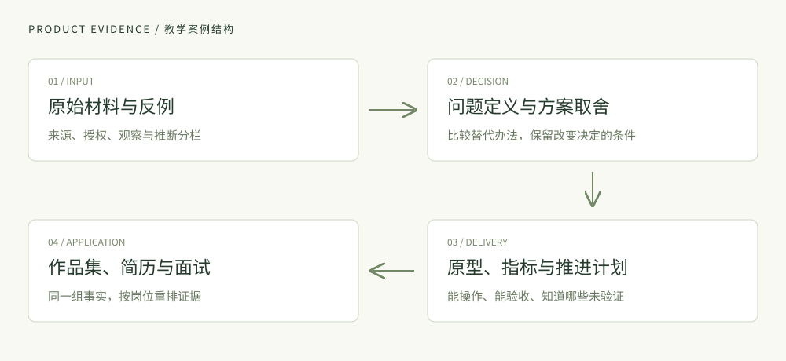

# 00 先完成一条能投递的产品证据链

作者：AI酋长Andy。版本：1.0.0。资料核验日：2026-11-13。

你要申请的是产品岗位。最终材料需要回答四件事：你怎样理解用户；你怎样判断问题；你放弃了什么方案；你怎样推动下一步。漂亮界面只能帮助别人看懂，不能代替这些证据。

本册面向中国留学生的产品实习、APM/毕业生项目和正式产品岗位。技术转产品、商科转产品、已有产品经历，都从真实 JD 出发。AI 产品经理在本册。算法、模型训练、模型工程岗位进入 AI 求职册；商业分析和经营分析按实际职责进入商科册。岗位边界以 JD 和招聘方解释为准。

## 今天的最小任务

**输入：** 你的毕业月份、在读状态、目标国家、可到岗时间，以及 3 条来自雇主官网的产品职位。

**操作：** 先排除明确不满足的资格条件。再从剩余岗位中选一个，列出 3 条关键职责。每条职责对应一个可展示的材料：原始研究记录、取舍说明、原型、指标口径或推进记录。没有就写“缺失”。

**产出：** 一张目标岗位卡、一张能力证据表、一项本周要补的工作。

**验收：** 你能用 60 秒说明“我申请哪个岗位、符合什么硬条件、用哪三件事证明匹配”。别人点开材料能看到证据，而不是一句自评。

**失败处理：** 找不到符合资格的岗位，先改申请路径。材料不足，先做小范围研究与验证。材料齐全但讲不清，做表达训练。不要用同一种补课方式处理三个不同问题。

## 按当前障碍开始

| 你的情况 | 先读 | 今天的产出 |
|---|---|---|
| 不知道海外 PM/APM/PO 有什么差别 | 01 真实岗位与要求；05 地区路线 | 3 张真实 JD 卡 |
| 技术背景，项目全是实现细节 | 02 路线与缺口；04 判断与取舍 | 一个“为什么做、为什么不做”的决策页 |
| 商科背景，只有调研和商业计划书 | 03 用户研究；06 贯穿案例 | 原始观察到产品决策的证据链 |
| 有实习，不能公开公司材料 | 07 申请材料 | 一份脱敏后的贡献与边界说明 |
| 做了作品集，面试追问答不上来 | 06 贯穿案例；09 面试实验室 | 5 个追问录音及复盘 |
| 工作许可或毕业窗口不确定 | 05 地区路线；10 申请操作 | 两封发给正确对象的核实邮件草稿 |
| 准备申请 AI 产品经理 | 01 真实岗位；08 AI 产品专项 | 非 AI 基线、评测表与失败回退方案 |

章节编号与网站、PDF一致。Markdown 源码中路径不同，网站导航提供统一入口。

## 完成后应有的 9 件材料

1. **目标岗位表：** 真实 URL、职位编号、地点、毕业/在读要求、工作授权问题与核验时间。
2. **能力证据表：** 每个 JD 要求对应材料位置、你的贡献和不能证明的内容。
3. **原始研究包：** 授权说明、原始笔记、观察与推断分栏。模拟材料必须单独标记。
4. **产品案例：** 问题、替代办法、至少两种方案、选择理由、未做事项。
5. **可点击原型：** 一个完整关键任务，包含错误、缺失信息和返回路径。
6. **指标与验证计划：** 分子、分母、观察窗口、护栏与停止条件。
7. **中英文申请材料：** 一份定向简历、短项目介绍和可公开作品集。
8. **面试训练包：** 产品设计、指标分析、执行、项目深挖、行为题的录音和复盘。
9. **申请台账：** 同时管理资格核验、毕业节点、材料版本和下一步日期。

## 如何使用教学模拟

本册的 OfferTrail 是教学模拟。示例雇主、申请记录、原始材料和候选人均为虚构练习。成品原型和文档可以检查；真实用户研究、真实招聘申请、上线效果、营收和增长均没有发生。读者复用时，必须用自己实际完成的工作替换材料，不能把整个案例复制为个人履历。

文中“已完成”只指交付包里实际存在的作品；“建议”是作者训练方法；“计划”是尚未执行的工作；“官方要求”必须附来源。引用公开 JD 是为了理解岗位，不代表这些职位仍开放，也不代表雇主背书本项目。

## 地区覆盖与边界

本册包含北美、欧洲、亚洲（含中国香港及中东）、大洋洲，以及回中国大陆申请。非洲、南美洲不在本次范围。05 章给出重点市场逐国核验卡，并为其他市场提供官方入口和核验方法；没有核实的国家不套用邻国政策。工作许可、学校实习安排、雇主资格是三个不同关口。

通用投递、内推、Offer 比较与入职流程可参阅 [how-to-get-offer](https://github.com/AIPMAndy/how-to-get-offer)。本册的产品案例与训练完整提供，无需先读其他书。留学生总攻略为独立项目；未确认其正式地址前，不生成猜测链接。

## 免费使用与咨询

正文、模板、样例、交互原型和 PDF 完整开放。你可以独立完成，不需要付费解锁章节。

需要具体反馈时，咨询只承接岗位定位、作品集诊断和模拟面试。请先准备目标地区、毕业月份、3 条 JD 和一份当前作品。咨询不承诺录用或涨薪。

**作者：AI酋长Andy**，流量 AI 联合创始人、星觉 AI 创始人。提供求职咨询、产品与 AI 转型陪跑。

微信：**AIPMAndy**。公众号：**AI酋长Andy**。个人官网：[metaver.vip](https://metaver.vip/)。公司官网：[a6no1.cn](https://www.a6no1.cn/)。
