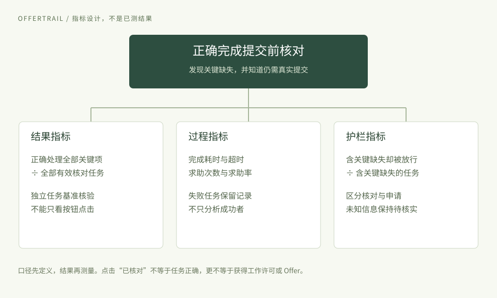

# 04 用方案取舍证明产品判断

产品案例最有价值的部分往往是你没有做什么，以及什么证据会让你改变决定。面试官可以从取舍中追问你的用户理解、资源判断与执行能力。

## 1. 建立可比较的方案

**输入：** 问题陈述、原始材料索引、时间与技术约束。

**操作：** 提出至少三种路径：继续现有做法；调整流程或模板；开发最小产品。用同一用户任务比较，不把某个方案的优点和另一个方案的缺点混着比。写明数据来源、依赖和失败后果。

**产出：** 一张方案比较表。列包括解决范围、使用成本、交付成本、错误代价、可验证性和放弃原因。

**验收：** 至少一个备选方案在某个维度优于你的首选。若你的方案处处都赢，检查比较是否公平。

**失败处理：** 没有成本资料就写估算依据和范围，不能把猜测工时包装成工程承诺。先请协作者评审最不确定的依赖。

## 2. 优先级：先处理阻断与不确定性

先过三个门：不做会不会让关键任务无法完成？错误会不会造成不可接受后果？这个功能能否在当前资源内验证？再比较收益和成本。不要用一个精确总分掩盖未经验证的假设。

| 教学练习中的需求 | 判断 | 第一版处理 | 依据边界 |
|---|---|---|---|
| 原始日期与来源可回看 | 关键路径 | 保留 | 便于发现信息缺失；仍待用户验证 |
| 时区缺失仍显示倒计时 | 高误导风险 | 禁止 | 输入不足，不应生成确定结论 |
| 一键自动投递 | 高依赖、超出目标 | 不做 | 需要账号授权、系统集成与不可逆提交控制 |
| 自动生成彩色作品集 | 与本轮任务关系弱 | 延后 | 不帮助核对截止时间和材料完整性 |
| 对资料齐全者显示核对结果 | 核心反馈 | 保留 | 只表示本地核对，不表示申请成功 |

这张表是 OfferTrail 模拟项目的设计判断，不是对全部留学生的实测结论。

**输入：** 方案比较表与约束。

**操作：** 把任务分成必须支持、可延后、明确不做。为前两项写一条反对意见，再说明为什么仍保留。

**产出：** 版本范围、决策日志、改变决定的条件。

**验收：** 每项第一版需求有原始依据或待验证假设；每项被砍需求有恢复条件。

**失败处理：** 全部都是最高优先级，重新限制本轮目标和资源；不能把所有业务愿望都放进同一个最小版本。

## 3. 原型交付到“能检查”的程度

一个关键原型至少包含：开始状态、正常路径、缺失信息、错误状态、完成反馈、返回/修改。操作之后用户应该知道发生了什么、哪些仍然不确定。

**输入：** 一个核心任务、字段清单和验收标准。

**操作：** 先画低保真。为每个字段写来源、格式、可否为空；为每个按钮写前置条件、状态变化和失败提示。先打通一个完整任务，再统一字体与颜色。

**产出：** 可点击原型、交互说明、正常及异常验收用例。关键图需要说明它对应哪一个决定。

**验收：** 新读者无需作者口头指导即可开始；必填缺失时不能“假完成”；浏览器回退和重置不会产生含糊状态。用键盘可到达主要控件。

**失败处理：** 原型只有跳页，补字段状态与校验。原型很大但没有完整任务，删到一条路径。技术限制导致无法实现的部分标为概念设计，不把截图冒充可运行产品。

## 4. 指标树：先定义正确完成，再谈活跃

不要把作品集里的北极星指标当装饰。对 OfferTrail 的核心假设，最直接的观察是“使用者能否发现并正确处理提交前的关键信息缺失”。实际测量前需要独立的核对基准，不能把点击按钮当作正确完成。

| 指标 | 计算口径 | 为什么看 | 易错点 |
|---|---|---|---|
| 核对正确率 | 正确处理全部预设关键项的任务数 / 全部有效核对任务数 | 是否完成任务 | 不把点完 checkbox 当正确 |
| 错误放行率 | 有关键缺失却显示已核对的任务数 / 含关键缺失的任务数 | 保护边界 | 分母不等于全部访问 |
| 任务耗时 | 从看到任务到给出核对结果的时间，记录未完成/超时 | 是否更易完成 | 不只保留成功样本 |
| 求助率 | 需要引导或解释的任务数 / 全部有效任务数 | 理解负担 | 引导后完成需另计 |
| 返回更正率 | 核对完成后发现需修改的任务数 / 已核对任务数 | 暴露漏检 | 可能代表审慎，不能直接当负面 |

没有观察数据时，“基线、结果、样本量”留空并写未测。可以设定测试通过门槛，但须标注为作者预设验收条件。

**输入：** 用户任务、错误类型、可记录事件和独立判断基准。

**操作：** 为每项指标写分子、分母、排除项、时间窗、去重单位和数据来源。先用 5 条手工样例走算；分母为 0 时显示“不适用”，不能填 0%。

**产出：** 指标字典、事件说明、验证计划。

**验收：** 两个人独立计算同一份数据，得出相同结果。能说明提升这个指标可能损害什么。

**失败处理：** 口径对不上先修定义。样本过小先查任务错误，不用“显著提升”下结论。没有随机对照，不把前后差异直接归因于设计。

## 5. 推进能力：没有团队也要有交接与依赖

**输入：** 一个版本范围、可用协作者与可公开的记录。

**操作：** 拆出三类工作：待决定、待执行、待验证。为每项写负责人、依赖、交付时间、验收人。真实多人协作保留讨论与决定；个人项目写“我完成的角色模拟”，不能编造设计师和工程师团队。

**产出：** 一页执行计划、变更记录、风险与回退表。

**验收：** 你能回答“哪个依赖影响时间”“意见不同时谁决定”“新增需求怎样影响范围”“怎么知道可以交付”。

**失败处理：** 截止前做不完时先减范围，保留完整关键路径；明确延期内容及影响。记录决定发生的时间，不事后伪造一个顺利的故事。

**案例的最后一页必须说清边界。** 已完成：当前可展示的文档、原型与检查。已观察：真实执行且有记录的研究或测试。尚未验证：需求强度、持续使用、商业价值。下一步：哪一个结果会让你继续、改方向或停止。这样既能展示成果，也能承受面试追问。
