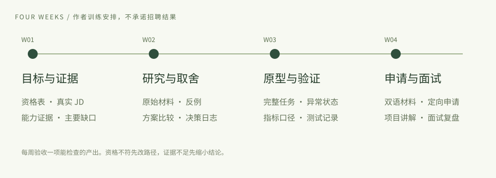

# 11 三十天交付计划与最后验收

本计划是训练安排。它不承诺三十天获得面试或 Offer。每周 6-10 小时可分批完成；时间更少就减少岗位和案例数量，保留证据链完整。

## 第一周：目标与证据

**输入：** 毕业安排、目标地区、5 条真实 JD、已有项目。

**操作：** 第 1-2 天核对路径与硬条件；第 3 天比较岗位职责；第 4-5 天整理能力证据；第 6 天确定一个主要缺口；第 7 天让他人审查资格表与案例选题。

**产出：** 主路径、备选路径、5 张 JD 卡、能力证据表、一个研究问题。

**验收：** 至少一条目标路径没有已知硬冲突；未知项有负责人/询问对象与日期。重点能力能指出材料或缺口。

**失败处理：** 资格不成立先改路径。选题无法接触用户或公开证据，缩小范围或更换选题。暂时只做模拟时从第一天就贴标签。

## 第二周：研究与取舍

**输入：** 研究计划、招募途径、公开边界。

**操作：** 完成授权与探索性研究；记录原话与推断；找反例；比较当前做法与至少两个方案；限制第一版范围。若真实研究无法执行，完成公开流程走查和可执行研究计划，状态保持“待验证”。

**产出：** 原始材料索引、问题陈述、方案比较表、决策日志。

**验收：** 一个重要决定能回到原始依据；至少有一个被否决方案；知道哪些事实尚未验证。

**失败处理：** 全是观点就回到具体任务；证据不支持选题就改问题，不为了保住原型继续找支持材料。

## 第三周：原型、指标与交接

**输入：** 版本范围与用户任务。

**操作：** 打通关键路径，加入缺失/错误状态；定义指标与测试条件；进行一次同伴检查和条件允许的真实任务观察；记录修订。AI PM 路线再加非 AI 基线、合成评测、人工接管与成本测量计划。

**产出：** 可运行原型、指标字典、验证记录/计划、依赖与验收清单。

**验收：** 正常和异常任务都有结果；原型实际能用；数据与表述一致。没观察的场景不写通过。

**失败处理：** 做不完先缩范围；若测试失败，展示失败与修订，不能删除失败记录只留成功截图。

## 第四周：申请与面试

**输入：** 主案例、JD 证据卡和可公开材料。

**操作：** 形成中英文定向简历与项目介绍；给作品集做陌生读者测试；按 09 章训练五类面试；完成符合资格的定向申请；保留材料版本和回执。

**产出：** 申请包、两段项目录音、面试复盘表、申请台账。

**验收：** 简历、作品集、原型和口述的事实一致；能解释一个失败、一个舍弃、一个待验证假设。申请状态有证据。

**失败处理：** 没有面试就先检查资格与材料匹配；有面试但项目追问卡住，就回到原始证据；只在陌生题卡住，拆成具体训练而非继续重做作品集。

## 每周用这张表复盘

| 问题 | 应留下的记录 | 下一步 |
|---|---|---|
| 哪条资格仍不确定？ | 官方链接/书面答复及时间 | 找正确对象核实或切换备选 |
| 哪个判断只靠猜测？ | 假设 ID 与影响 | 做最便宜的验证 |
| 哪个材料最能证明匹配？ | JD 条目→材料具体位置 | 放到申请包前部 |
| 哪个数字无法解释？ | 数据来源、口径缺口 | 删除或补核验，不编造 |
| 哪次面试失败可修复？ | 原题、原回答、具体遗漏 | 重答并录音，再评一次 |

## 提交前的十项检查

1. 真实 JD 和申请入口仍可访问，核验时间有记录。
2. 学历、毕业日期、语言、地点、到岗与授权问题按真实情况填写。
3. 项目类型、团队规模、本人贡献、完成状态准确。
4. 模拟材料在摘要、正文、图表和简历里都有标记。
5. 所有数字可追溯；目标值、预测与实际结果分开。
6. 作品中的用户数据和公司资料得到允许公开的授权。
7. 主要原型流程可完成，异常路径不误导。
8. PDF 文字可选择，链接能打开，手机能读。
9. 说得出至少一项取舍、一个反例和一项没验证的假设。
10. 联系方式、附件名、材料版本与申请岗位一致。

## 什么时候值得找外部反馈

岗位定位：拿 3 条 JD 与自己的证据表来讨论。作品集诊断：带上原始记录、主案例与原型；只发封面无法判断能力。模拟面试：提供目标岗位、最弱题型和一段原始回答。先明确想解决的问题，再决定是否购买服务。

作者：**AI酋长Andy**。微信：**AIPMAndy**。公众号：**AI酋长Andy**。个人官网：[https://metaver.vip/](https://metaver.vip/)。公司官网：[https://www.a6no1.cn/](https://www.a6no1.cn/)。免费内容完整开放；咨询不承诺录用或涨薪。
