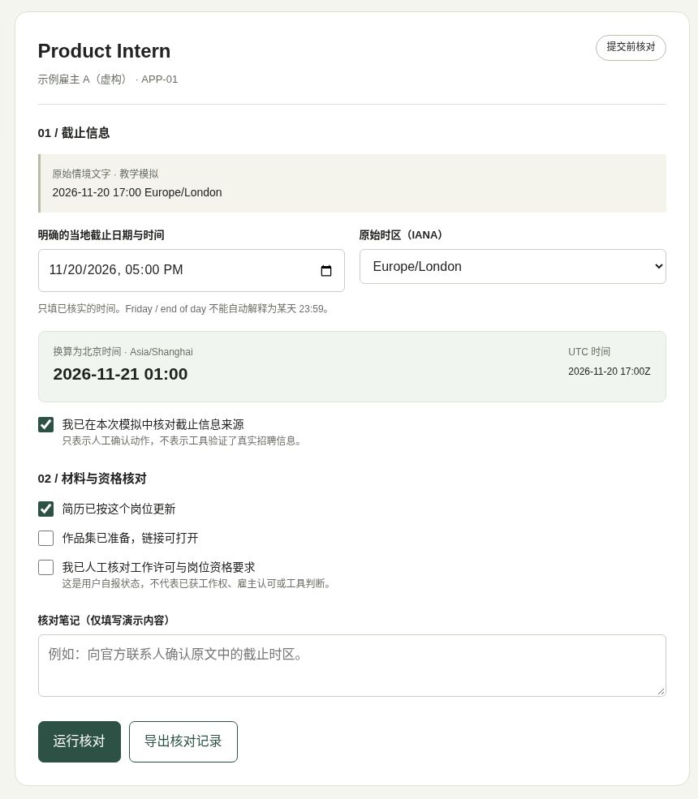

# 06｜贯穿案例：把一组原始材料变成可追问的产品证据

**案例：OfferTrail，跨时区申请提交前的最后一次核对。**

版本 1.0.0｜2026-11-13｜作者：AI酋长Andy

> **教学模拟边界**：本章的申请者、雇主、岗位数据和六条情境材料都是作者编写的。没有开展真实访谈，没有真实上线，没有申请成功率、营收或用户增长结果。我们展示的是一套可以检查的分析与设计过程。真实求职者应使用自己的项目重做，并如实区分已经完成与尚未验证的部分。

## 先看最终要交什么

这个案例最后形成七类证据：原始材料包、问题与假设表、方案比较、可交互原型、指标与验证计划、作品集、简历与面试讲解。面试官可以沿着同一条链追问：你看见了什么，为什么这样理解，有哪些反例，为什么选择这个方案，下一步怎么证明它值得做。

| 产物 | 本册成品 | 能证明什么 | 不能证明什么 |
| --- | --- | --- | --- |
| 模拟原始材料 | [S01–S06](../../examples/offertrail-raw-materials.md) | 知道怎样记录来源、保留反例 | 做过真实用户研究 |
| 研究计划 | [招募与任务脚本](../../examples/offertrail-research-plan.md) | 能把假设变成可执行的验证 | 研究结果已经成立 |
| 决策记录 | [决策日志](../../examples/offertrail-decision-log.csv) | 取舍有理由、有推翻条件 | 方案一定正确 |
| 原型 | [运行 OfferTrail](../../prototypes/offertrail.html) | 能把规则落到可操作界面 | 真实上线、替人申请 |
| 指标与测试 | [指标表](../../examples/offertrail-metrics.csv)、[测试任务](../../examples/offertrail-test-cases.csv) | 口径明确、风险可检验 | 产品改善了商业结果 |
| 作品集 | [完整案例页](../../examples/offertrail-portfolio.md) | 能清楚讲述问题、证据和判断 | 该求职者亲自做过本教材 |
| 申请表达 | [中英文简历](../../examples/resume-zh.md)、[项目讲解](../../examples/project-pitch-zh-en.md) | 能按真实项目状态表达 | 有真实任职、录用或实习关系 |

读本章时，先打开原型，再看每一步为什么存在。不要先花一周给作品集换字体。

图示为本项目可运行教学原型的实际截图。所有雇主与申请均虚构。页面操作只改变本地状态。

## 第 1 步：限定要解决的任务

### 输入

六条模拟情境 S01–S06。假设目标人群是“正在跨地区申请、需要自己整理截止时间和材料的中国留学生”。这只是研究对象定义，不是已经确认的市场。

### 操作

把“大而全求职助手”缩成一次具体任务：提交前，申请者需要确认原始截止信息、自己所在时区的时间、必需材料，以及仍未解决的资格问题。我们暂不处理岗位推荐、简历改写、自动投递、Offer 选择。

写下一个可以失败的问题表述：

> 当申请者同时处理不同时区的岗位时，是否难以在提交前确认“截止信息是否明确、材料是否完整、还有没有待核实项”？如果现有表格与日历已经能可靠完成，该问题未必需要一个新产品。

### 产出

一页范围说明：目标任务、目标人群、研究假设、排除项、现有替代方案。

### 验收

读者能说出用户要完成的动作，而不是只能说“提高求职效率”。范围中包含至少一个“可能不需要新产品”的条件。

### 失败处理

如果一句话仍然涵盖“推荐岗位、自动投递、签证判断、面试辅导”，继续删。先选择一个高频、可观察、可结束的任务。没有真实材料时保留“假设”，不要给假设换成“痛点已验证”的标题。

## 第 2 步：把原话、观察与解释分开

### 输入

[原始材料包](../../examples/offertrail-raw-materials.md)。本案例共六条作者编写情境，不是六位受访者。

### 操作

为每条材料保留 ID、来源类型、原始内容、解释、其他解释和待验证问题。先承认材料强度，再讨论方案。

| ID | 模拟情境的关键事实 | 初步解释 | 反例 / 其他解释 | 状态 |
| --- | --- | --- | --- | --- |
| S01 | 原文有伦敦时间，申请者在北京整理 | 跨时区核对可能增加认知负担 | 系统日历可能已解决 | H1，待验证 |
| S02 | 原文只写 Friday end of day | 信息不全时不应给确定时间 | 官方系统可能写得更清楚 | R1，设计风险 |
| S03 | 简历、项目链接和要求在不同地方 | 提交前清单可能有帮助 | 低负担申请者不需要 | H2，待验证 |
| S04 | 申请者不确定工作许可要求 | 需要人工查官方信息 | 本工具不应判断个人资格 | 边界条件 |
| S05 | 表格加日历已足够 | 新工具可能没有增量价值 | 多地区申请者可能不同 | H3，待验证 |
| S06 | 系统把模糊时间自动填满并变绿 | 自动化可能制造虚假确定性 | 清楚标注来源也许够用 | R2，设计风险 |

### 产出

一张问题与假设表。任何“用户需要”都能指向材料，任何材料都能看见其真实性状态。

### 验收

删除 S05 后方案显得更漂亮，但保留 S05 后判断更可信。合格的案例必须保留反例。不能写“调研六位留学生发现……”或“访谈证明需求强烈”。

### 失败处理

如果真实项目只有自己的体验，把它写成“个人经历提出的假设”。如果只有朋友评价，把朋友是否符合目标人群、评价过程和限制写清楚。证据少，可以缩小结论；不能补造更多证据。

## 第 3 步：定义问题与成功条件

### 输入

H1、H2、H3 与风险 R1、R2。

### 操作

将“大幅提升效率”拆成可以观察的任务结果：申请者能否正确识别明确与模糊的截止信息；能否发现缺少的必需材料；能否理解“核对完成”不等于“已经申请”。

本案例的任务定义如下：

| 任务 | 成功判断 | 关键失败 |
| --- | --- | --- |
| T1：核对 APP-01 | 正确读出北京截止时间，发现作品集与许可核对未完成 | 把伦敦日期直接当北京时间；漏掉阻塞 |
| T2：处理 APP-02 | 指出日期/时区不明，并提出查看官方系统或人工确认 | 自行填成最近的周五 23:59 |
| T3：结束核对 | 知道仍需回到雇主官方系统提交并保存回执 | 误以为点击按钮已经投递 |

### 产出

问题定义、三个任务、可观察成功条件、关键失败清单。

### 验收

每个成功条件都能通过一次任务观察判断。没有用“喜欢页面”“感觉高级”“注册了账号”替代完成任务。

### 失败处理

若测试者与观察者对“完成”理解不同，先改口径。若没有资源衡量长期录用结果，诚实地只评估当前任务，不把短期可用性推出长期录用效果。

## 第 4 步：比较方案，说明为什么没有选其他方案

### 输入

问题定义、现有表格/日历方案、最重要的误导风险。此时没有真实需求数据，也没有开发工时测量。

### 操作

比较三种可行办法。不要为缺乏依据的维度打一个精确的 8.7 分。

| 方案 | 能解决什么 | 主要代价 | 失败方式 | 本轮决定 |
| --- | --- | --- | --- | --- |
| A：表格与日历 | 集中存放日期和清单，学习成本低 | 依赖使用者维护；规则提示较弱 | 信息漏填或过期却没被发现 | 作为基线，保留可编辑模板 |
| B：人工来源核对 + 规则提示 | 明确显示未知项，阻塞有原因，便于演示 | 仍需人工录入；多一个维护入口 | 用户为了变绿随意勾选 | 作为待验证原型 |
| C：AI 抽取 + 自动判断 | 可能减少录入动作 | 需要可靠来源、评测与失败处理 | 把模糊信息补成确定答案 | 本轮不做自动判断 |

选择 B 的理由很窄：本轮要验证的是“明确展示未知项、让缺失项阻塞，是否帮助用户做正确核对”。B 更容易观察这个问题。它不意味着 B 的市场需求已经成立，也不意味着 A 一定更差。

### 产出

[决策日志](../../examples/offertrail-decision-log.csv)。每条记录包含当时证据、选择、代价、推翻条件。

### 验收

能回答三件事：为什么选它、因此失去了什么、看到什么证据会改选。一个只写“综合考虑后选 B”的表格不合格。

### 失败处理

如果 B 只是因为“做网页看起来像产品经理”，退回 A。真正的产品判断允许最后交付一个表格。若新增自动化，单独说明错误代价、来源、回退和验证；不要悄悄把 C 塞进 B。

## 第 5 步：排优先级，用规则约束原型

### 输入

方案 B、T1–T3、R1–R2。没有真实覆盖人数和业务收益数据，所以不使用伪造的 RICE 数字。

### 操作

按“是否是当前任务的必要条件、错误是否会误导、能否更低成本实现”排序。

| 层级 | 功能 / 规则 | 为什么现在需要 |
| --- | --- | --- |
| 必须 | 原始截止信息与来源状态并列 | 防止转换结果掩盖原文缺失 |
| 必须 | 时区明确后才显示本地时间 | 不把未知时间变成确定答案 |
| 必须 | 必需材料、人工核对状态和阻塞原因 | 支撑提交前任务 |
| 必须 | 核对完成后明确“未真实提交” | 避免把演示误认为申请系统 |
| 本轮可做 | 导出本地核对记录、重置模拟数据 | 便于复盘和重复演示 |
| 暂不做 | 账号体系、岗位推荐、自动投递 | 不服务本轮最小验证 |
| 暂不做 | 自动判断工作许可 | 超出产品和证据边界 |
| 后续假设 | AI 提取字段后由人确认 | 需要另建评测和来源核对，尚未验证 |

### 产出

范围清单、状态机、验收用例。完整规则见[原型规格](../../examples/offertrail-prototype-spec.md)。

### 验收

每个“必须”能对应一个任务或风险。未知状态有界面和动作，不藏在错误弹窗里。人工核对完成后更改关键字段，应重新进入待核对状态。

### 失败处理

如果做不完，先保留 APP-01 与 APP-02 两种情况。前者验证明确时间，后者验证不确定性。不要为了赶工删除模糊情况，让原型只剩顺利路径。

## 第 6 步：让原型表现你的判断

### 输入

固定的三条虚构申请、优先级清单、关键失败条件。

### 操作

打开[可交互原型](../../prototypes/offertrail.html)，依次走四个状态：选申请、看来源与材料、运行核对、人工确认。每个动作都回答一个产品问题。

| 原型位置 | 用户看到什么 | 体现的判断 |
| --- | --- | --- |
| 申请卡片 | 岗位、原文截止信息、未完成项 | 先看风险，再看装饰 |
| 时间区域 | 原始日期、时区、本地时间 | 转换结果必须可追溯 |
| 待核实项 | APP-02 不展示猜测时间 | 缺失信息本身是有价值的状态 |
| 材料清单 | 必需项与完成状态 | 区分“有文件”与“已按本岗位核对” |
| 人工确认 | 本地核对完成，尚未提交 | 产品不能声称做了没有做的动作 |

APP-01 使用 `2026-11-20 17:00 Europe/London`，示例北京时间为 `2026-11-21 01:00`。APP-03 使用 `2026-11-24 17:00 America/New_York`，示例北京时间为 `2026-11-25 06:00`。这些都是测试数据，不是招聘截止日期。

APP-02 只写 `Friday end of day`。原型的正确行为是保留未知状态，引导确认。若系统自己补全了日期或时区，即使页面漂亮，这个设计也失败了。

### 产出

能点击的演示、原型截图、关键状态说明。截图应带上模拟标签，不能让脱离上下文的图片看起来像真实招聘信息。

### 验收

键盘可以操作；手机能完成核心流程；阻塞原因能读懂；点击不会实际提交；重置能恢复初始状态。工程测试只能证明原型按规则运行，不能证明真实用户需要它。

### 失败处理

若没有时间写前端，用可点击设计稿或带状态的表格也可以，但要明示交互边界。不可把静态截图写成已开发产品。原型无法打开时，提供本地文件与关键状态截图，并在作品集标注问题。

## 第 7 步：画指标树，先定义分母

### 输入

T1–T3、研究计划、拟比较的 A 与 B 两种方案。

### 操作

把目标拆成任务结果、过程成本和误导风险。原型里的点击量不是用户价值本身。

| 层级 | 指标 | 口径 | 为什么看 |
| --- | --- | --- | --- |
| 任务结果 | 正确完成率 | 独立完成指定任务且无关键错误的尝试数 / 所有有效任务尝试数 | 是否做对，而不只是点完 |
| 任务结果 | 模糊信息识别率 | 对 T2 正确指出缺日期/时区并要求核实的尝试数 / T2 有效尝试数 | 是否避免错误确定性 |
| 过程成本 | 核对用时 | 从任务展示到完成或放弃；分别报告完成与未完成 | 避免删掉失败者后宣称更快 |
| 过程成本 | 求助次数 | 同一任务中向主持人索取操作提示的次数 | 看是否依赖指导 |
| 保护指标 | 误以为已申请的次数 | T3 回答已经提交的尝试数 | 检查关键误导 |
| 保护指标 | 敏感信息输入 | 原型中输入真实证件或账号信息的事件数 | 发现不必要的数据收集 |

详细事件定义见[指标表](../../examples/offertrail-metrics.csv)。同一人多次尝试应保留参与者 ID 和轮次，不把重复尝试当成独立用户。没有实施测试，不填写看似真实的数值。

### 产出

指标树、事件字段、分子分母、排除规则、错误分类。作品集显示“尚待采集”，不是一张没有来源的增长曲线。

### 验收

另一位同学拿到任务记录，能按同一口径重新算出结果。完成率与失败原因一起看；快但做错不算成功。

### 失败处理

样本少时，报告每个任务的具体问题和人数，不推断整体市场。没有对照与可比条件，不把观察差异写成因果。若指标无法采集，先简化为人工观察表。

## 第 8 步：写出可执行的验证与推进计划

### 输入

研究假设、原型、A 方案表格、任务卡和隐私边界。

### 操作

先观察真实申请者现有做法，再测试原型。具体招募与主持脚本见[研究计划](../../examples/offertrail-research-plan.md)。以下是计划示例，没有执行结果。

| 工作包 | 责任角色 | 完成定义 | 依赖 | 失败时的动作 |
| --- | --- | --- | --- | --- |
| W1：确认问题 | 研究负责人 | 原始笔记、反例、同意范围可追溯 | 找到目标参与者 | 招募失败则保留假设，不伪装成研究 |
| W2：比较替代方案 | 产品负责人 | 同任务使用表格与原型的记录 | W1、任务脚本 | 表格已足够则停止新增功能 |
| W3：修正关键误导 | 设计/实现负责人 | T2、T3 的措辞与状态修订 | 实际观察或专家检查 | 有误导先修正，再扩大范围 |
| W4：记录结论 | 项目负责人 | 哪些保留、哪些删除、为什么 | W1–W3 | 证据不足时安排下一轮，而非写成功总结 |

个人项目中，一个人可以承担多个角色，但不要写“带领研发、设计、运营团队”来包装自己。可以说明你负责全部分析与原型实现，哪些部分由工具辅助。

### 产出

下一轮计划、负责人、依赖、完成定义、决策检查点。

### 验收

每个任务都能转成日历上的动作，完成后有可检查文件。计划中有停止条件，没有把所有路径都通向继续开发。

### 失败处理

真实用户无法接触时，先让同学做可用性检查或让导师做专家评审，但明确它们不能替代目标用户需求验证。不要把“老师觉得不错”写成“用户需求得到验证”。

## 第 9 步：整理为作品集，保留薄弱处

### 输入

材料、决策日志、原型、测试状态和验证计划。

### 操作

按“问题与范围→证据强度→方案比较→关键原型→指标与下一步”整理。把所有未验证内容放在读者能看见的位置。首页明确项目类型、个人职责、哪些是已完成材料、哪些是计划。

一个合格首页摘要可以这样写：

> OfferTrail 是一个关于跨时区申请核对的教学模拟案例。我用六条作者编写的情境比较了三种方案，选择“人工来源核对与规则提示”作为待验证原型。案例保留了模糊截止时间和许可待核实状态，没有自动投递，也没有真实用户验证或业务结果。下一步是与表格基线做同任务比较，判断是否值得继续开发。

### 产出

[完整作品集成品](../../examples/offertrail-portfolio.md)。它不依赖读者猜测截图背后的推理。

### 验收

面试官两分钟能知道你的角色、最重要取舍和当前证据限制。继续追问时，能找到原始材料、反例和决策日志。

### 失败处理

如果只能展示十张高保真图，补“为什么这样设计”的材料。如果每页都是框架名，删去不能改变决策的框架。若你只是复刻本教材，作品集必须写“复刻练习”，不能写原创真实项目。

## 第 10 步：写简历，练习被追问

### 输入

目标岗位的真实 JD、你的真实参与记录，以及可公开的产物。教材案例不是用户自己的履历。

### 操作

先找 JD 中需要证明的行为，再选证据。需要“用户理解”就展示来源与反例；需要“优先级”就展示删掉什么；需要“推进”就展示依赖和验收。没有真实上线时，用产物与判断写结果，不强加增长数字。

**中文教学表达：**

> OfferTrail｜产品分析与原型教学练习。基于六条明确标记为模拟的申请情境，比较表格、规则核对和 AI 自动判断三种方案，形成问题定义、决策日志、交互原型及验证计划；为模糊截止时间设计阻塞与人工核实流程，尚未开展真实用户测试。

**English teaching example:**

> OfferTrail — Product case exercise. Compared a spreadsheet workflow, rule-based checks and AI-assisted automation using six explicitly synthetic scenarios. Created a problem definition, decision log, interactive prototype and validation plan; kept ambiguous deadlines blocked pending manual verification. No live launch or user-study results are claimed.

完整申请材料见[第 07 章](07-application-materials.md)。练习讲解时，先说最重要取舍，再解释证据，不按“我做了用户画像、竞品分析、流程图……”报菜名。

### 产出

一条与事实匹配的简历项目、两分钟中英文讲解、五分钟展开版、项目追问清单。

### 验收

以下问题都能不编造地回答：你亲自做了什么？哪些用户是真的？为什么不是表格？什么证据能推翻你？原型能做什么、不能做什么？如果再给你一周，会先验证哪一个不确定性？

### 失败处理

若讲解需要补造访谈或业绩才能成立，回到项目本身补证据。能力缺口靠行动补；表达缺口靠结构补。不要把表达训练用来遮住经历缺口。

## 本案例的事实核对表

| 项目 | 可以写 | 不可以写 |
| --- | --- | --- |
| 原始材料 | 六条作者编写的模拟情境 | 访谈六位真实留学生 |
| 研究 | 提出问题、招募与观察计划 | 需求已被验证 |
| 决策 | 比较三方案，选择待验证原型 | 找到最优市场方案 |
| 产品 | 本地可交互核对演示 | 真实上线、自动投递 |
| 结果 | 完成的文件、规则和原型 | 提升录用率、用户增长、营收 |
| 角色 | 教材作者/复刻练习者的实际动作 | 不存在的实习、团队领导经历 |
| 来源 | 教学模拟标签；真实信息另查官方来源 | 用虚构雇主当真实岗位信息 |

作者：AI酋长Andy｜微信：AIPMAndy｜公众号：AI酋长Andy  
个人官网：https://metaver.vip/ ｜公司官网：https://www.a6no1.cn/

免费内容完整开放。咨询可用于岗位定位、作品集诊断与模拟面试，不承诺录用或涨薪。
